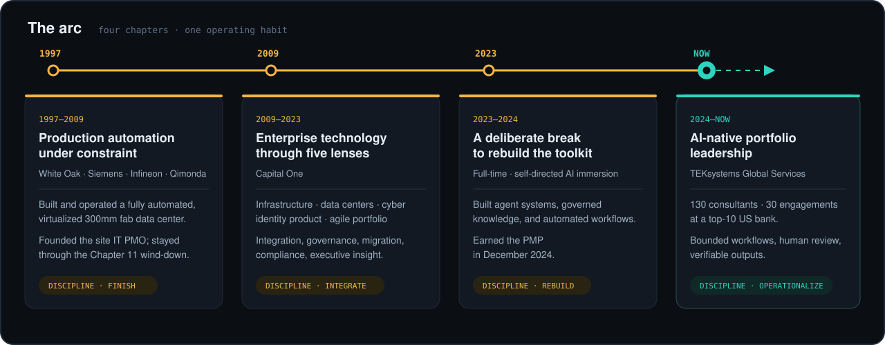
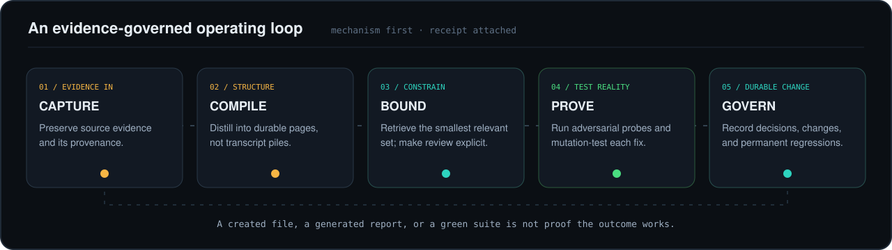
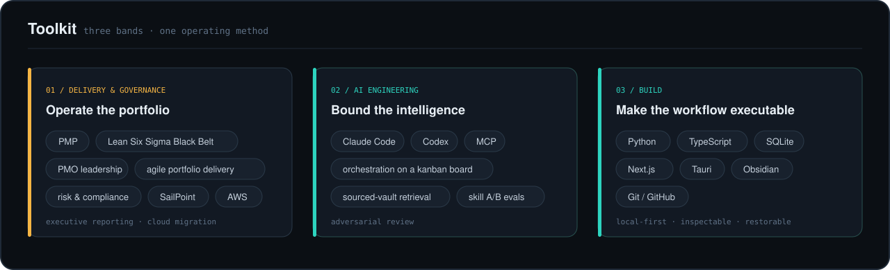
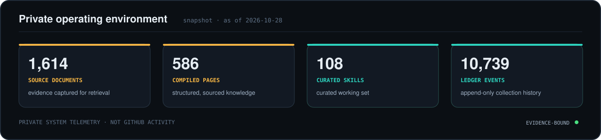

  

 

  
  
  
  
  

 

## `>` whoami

I am an enterprise delivery leader who builds. I learned the work in production environments where uptime, evidence, and clean handoffs mattered more than presentation. Nearly three decades of production operating discipline. Now pointed at AI.

Today I lead a delivery portfolio while building governed knowledge, decision, and automation systems. My method is consistent: bound the problem, preserve the evidence, put a human at the consequential decision, and prove the outcome.

Most of my work stays private on purpose. What follows is the part of the record I can make visible.

 

## `>` the arc

<picture>
  <source media="(prefers-color-scheme: dark)" srcset="./assets/arc-dark.svg">
  <source media="(prefers-color-scheme: light)" srcset="./assets/arc-light.svg">
  
</picture>

 

## `>` what I'm building

All six are private repositories or private client work; descriptions are intentionally bounded.

<table>
<tr>
<td width="50%" valign="top">

### ◈ Banuitt Brain
**Governed second brain · operating environment**

An Obsidian-format sourced vault with 1,614 source documents compiled into 586 knowledge pages. Claude Code and Codex workers move through a kanban board, with MCP servers, 108 curated skills, and a memory store made of distilled entries rather than raw transcripts.

`Obsidian` `MCP` `Claude Code` `Codex` `retrieval`

</td>
<td width="50%" valign="top">

### ◇ Evidence-governed résumé system
**Claim control · bounded public wording**

A claim ledger, frozen job-specific benchmark, gating audit checks, and refusal list. It can withhold keyword credit and reject a stronger summary when the source record does not support it.

`Python` `evidence` `audit gates` `adversarial review`

</td>
</tr>
<tr>
<td width="50%" valign="top">

### ⟁ Portfolio decision layer
**Weekly governed decision support · built inside the client**

Turns delivery evidence for 130 consultants across 30 engagements into staffing reconciliation, funding runway, and roll-off planning. Human review stays explicit; outputs remain verifiable.

`portfolio delivery` `reconciliation` `governance` `human review`

</td>
<td width="50%" valign="top">

### ◫ BanuittMTG
**Physical collection ledger · remote tabletop companion**

Tracks 4,596 physical cards, 10,739 append-only events, 13 deck builds, and 1,013 automated tests. Staged changes show a readable preview before one confirmation. A TypeScript tabletop companion is in progress for remote play with the physical cards you own.

`Python` `SQLite` `Scryfall data` `TypeScript` `append-only`

</td>
</tr>
<tr>
<td width="50%" valign="top">

### ◎ Private meeting intelligence
**Allowed recordings → compiled knowledge**

Voice recordings become transcripts, receive salience scoring, and compile into knowledge. A per-file allowlist means nothing is processed until it is explicitly let in. Pilot complete.

`transcription` `salience scoring` `allowlist` `knowledge compilation`

</td>
<td width="50%" valign="top">

### ⌁ Capability lab
**Curated skills · measured entry to the working set**

Capabilities are risk-scanned, tested against real work, and quarantined reversibly when risky or unused. One job-specific skill showed no measurable lift in an A/B evaluation, so it was never installed.

`evals` `A/B testing` `risk scan` `reversible quarantine`

</td>
</tr>
</table>

 

## `>` how I operate

<picture>
  <source media="(prefers-color-scheme: dark)" srcset="./assets/method-dark.svg">
  <source media="(prefers-color-scheme: light)" srcset="./assets/method-light.svg">
  
</picture>

 

## `>` receipts

> **The record can say no.** My résumé system refused my submitted tenure summary because the dates did not support it. It also withheld keyword credit when earning it required a stronger claim than the evidence supported.

> **Green is not the same as proved.** “24 tests pass” was true and meaningless: the suite stayed green while the defect was live. Now a fix is mutation-tested before merge—revert it, see the intended tests fail, restore it, confirm green.

> **The guard was worth more than the capability.** A skill built for a real job showed no measurable lift in an A/B evaluation and was never installed. A guard executes; guidance only advises.

> **Memory needs distillation.** Bulk-storing raw transcripts destroyed an earlier store. The correction is deliberate: scheduled distillation into short entries filed within a fixed taxonomy.

 

## `>` toolkit

<picture>
  <source media="(prefers-color-scheme: dark)" srcset="./assets/toolkit-dark.svg">
  <source media="(prefers-color-scheme: light)" srcset="./assets/toolkit-light.svg">
  
</picture>

 

## `>` telemetry

<picture>
  <source media="(prefers-color-scheme: dark)" srcset="./assets/telemetry-dark.svg">
  <source media="(prefers-color-scheme: light)" srcset="./assets/telemetry-light.svg">
  
</picture>

Every claim on this page traces to a sourced record. Where the record is qualitative, so is the page.

  

---

  <b>Production operating discipline since 1997 · now pointed at AI</b>
    
  <a href="mailto:peter.banuitt@gmail.com"><b>peter.banuitt@gmail.com</b></a>

